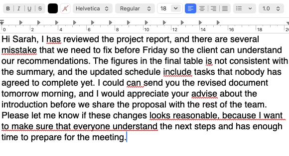
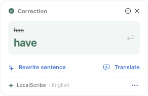
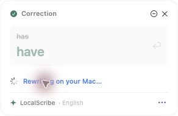
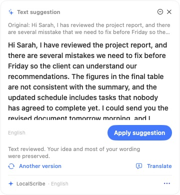
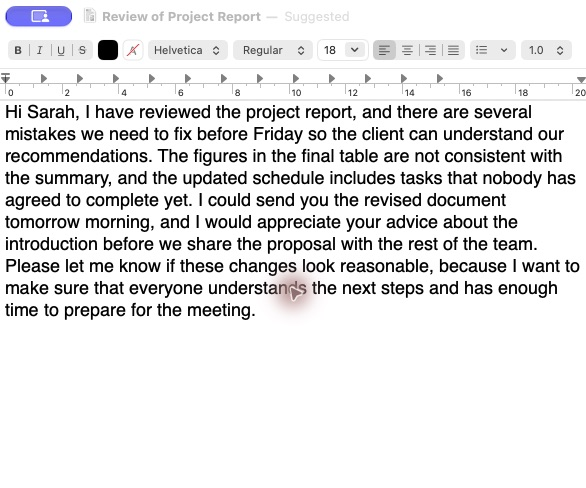
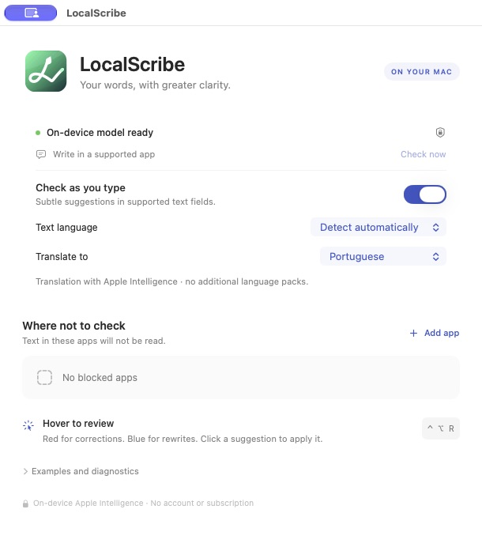

# LocalScribe

A macOS writing assistant powered by on-device Apple Intelligence. It detects the language of your text, displays corrections and suggestions next to the text field, and applies only the suggestions you accept. No app account, custom backend, or subscription required.

**Latest release: 0.8.2 · Apple Silicon · macOS 26.4 or later.**

Version 0.8.2 makes the selected translation target explicit in model instructions and demonstration cards, and uses English throughout the implementation and localization keys. It also includes the safeguard against changing named weekdays during translation.

## Installation

**[Download LocalScribe 0.8.2](https://github.com/alexvingg/LocalScribe/releases/tag/v0.8.2)** — choose the DMG or the ZIP that preserves its Finder icon metadata.

Extract the ZIP, open the DMG, and drag LocalScribe to Applications. The ZIP preserves the green file icon metadata; the mounted volume also includes the icon. SHA-256 checksums are available in the release assets.

On first launch, allow **LocalScribe** in System Settings → Privacy & Security → Accessibility. The app lives in the menu bar. The current distribution is ad hoc signed and does not yet have Developer ID signing or Apple notarization; see the [installation instructions](Support/INSTALL.txt).

Your Mac must support Apple Intelligence, with the on-device model enabled and available. In version 0.8.0, translation reuses this model without additional language packs.

## Features

- Automatic source language detection, with an optional manual override.
- Fast spell checking with the macOS dictionary and on-device grammar and sentence structure review.
- Underlines and word or sentence suggestion cards in text fields that expose the required Accessibility capabilities.
- Conservative rewriting that preserves your meaning and reviews the complete proposal before displaying it.
- Verified changes in the editor, preserving independent pending corrections and reusing the review of an accepted sentence.
- On-demand translation of the displayed suggestion into your chosen language, using the same on-device model.
- Interface follows the macOS language: Portuguese and English, with English as the fallback.
- An app blocklist, a pause control, and the **Control + Option + R** shortcut.
- Temporary text and field caches, with chunked review to stay within the model budget.
- A green vector app icon and an adaptive monochrome menu bar icon.

## In action

A real TextEdit walkthrough with a **112-word English passage**, using LocalScribe 0.8.0. The text is synthetic; the screenshots show the actual editor and live assistant cards. See the [original passage](Fixtures/readme-demo.txt), [result read back from TextEdit](Fixtures/readme-demo-reviewed.txt), and [validation notes](docs/TEXTEDIT_SHOWCASE.md).

### Review a longer passage

LocalScribe detected English automatically and found seven suggestions in this passage. The screenshot below, provided by the author, shows the red underlines in the editor.



### Correct individual words

A compact card proposes **has → have**. You can apply the correction or request a sentence rewrite.



### Rewrite while preserving the idea

The card shows progress while the local model works. The resulting proposal keeps the message about the project report, Friday deadline, schedule, and team meeting. Long proposals can be scrolled before applying.





### Apply the reviewed proposal

Clicking **Apply suggestion** updated the real TextEdit document. The result was verified by reading the text back from the editor: **have**, **mistakes**, **are**, **includes**, **could**, **advice**, **look**, and **understands** appear in the corrected passage.



### Translate only when requested

A separate short example shows the translation inside the suggestion card: **I could go there. → Eu poderia ir lá.** The translation can be copied or hidden without replacing the English text. This screenshot also demonstrates the Portuguese interface.


### Choose languages and block apps

Writing language detection, translation destination, pause, and the app blocklist are configured in one window. The interface below follows the Mac's English language setting.




## Current compatibility

| App or text field | Available evidence |
| --- | --- |
| WhatsApp in Chrome | Text reading, suggestion cards, and verified changes in the tested message composer. |
| Slack desktop | Text reading, text geometry, and verified changes in the tested message composer. |
| Teams desktop | Text reading, suggestion cards, and verified changes; accepted proposals reused without another generation. |
| TextEdit | Native integration and changes exercised during development. |
| Safari, Firefox, and other text fields | Shared integration implemented; real-world validation still pending. |

Compatibility depends on the text field, app version, and available APIs. Secure fields and blocked apps are excluded from review. The model may make mistakes or decline to review some passages; no suggestion is applied automatically. See [docs/INTEGRATION_ARCHITECTURE.md](docs/INTEGRATION_ARCHITECTURE.md) for detailed coverage.

## Build and test

Requires Swift and Command Line Tools with an SDK that supports FoundationModels. The project has no third-party dependencies and does not use generation macros.

```sh
./scripts/build-app.sh
open dist/LocalScribe.app
```

The build produces the app and icon resources in `dist/`, with an ad hoc signature.

```sh
.build/release/WritingCoreChecks
python3 scripts/check-localizations.py
dist/LocalScribe.app/Contents/MacOS/LocalScribe --translation-configuration-smoke
dist/LocalScribe.app/Contents/MacOS/LocalScribe --translation-smoke
dist/LocalScribe.app/Contents/MacOS/LocalScribe --diagnose
dist/LocalScribe.app/Contents/MacOS/LocalScribe --proposal-stability-smoke
```

The core suite contains 64 checks. The last command uses the real on-device model to verify English and Portuguese proposals and review reuse; it does not write to an external editor. Additional checks are documented in [docs/VALIDATION.md](docs/VALIDATION.md).

To package an existing build:

```sh
./scripts/package-dmg.sh
```

The script creates and verifies the DMG, the file and volume icons, and the ZIP that preserves Finder metadata.

## Source language and localization

Implementation code, prompts, diagnostics, and localization keys are written in English. Portuguese interface text lives in its localization catalog. Language-specific review words and multilingual regression samples are bundled JSON data. The macOS interface language and the translation target selected in **Translate to** are independent. See [translation and localization](docs/LOCAL_TRANSLATION_AND_LOCALIZATION.md) for the resource layout and validation commands.

## Project structure

```text
Sources/LocalScribe/  UI, Accessibility, and on-device Apple services
Sources/WritingCore/ Text ranges, suggestions, chunking, caching, and policies
Checks/              Executable core regression checks
Fixtures/            Synthetic editors and test text
Support/             Info.plist, installation instructions, and icon assets
scripts/             Build, vector rendering, and DMG packaging
docs/                Specifications, plans, analysis, evidence, and validation
downloads/           Published installer and checksum
```

## Documentation

[On-device translation and localization](docs/LOCAL_TRANSLATION_AND_LOCALIZATION.md) · **[Full documentation index](docs/README.md)** · [Reference specification](docs/CLONE_SPEC.md) · [Apple Intelligence plan](docs/APPLE_INTELLIGENCE_PLAN.md) · [Implementation](docs/IMPLEMENTATION.md) · [Review stability after applying suggestions](docs/PROPOSAL_STABILITY.md).

The research documents observed behavior and marks what remains unknown. LocalScribe uses its own code and visual identity; the evidence indexes do not redistribute the implementation or resource catalogs of the product studied.
