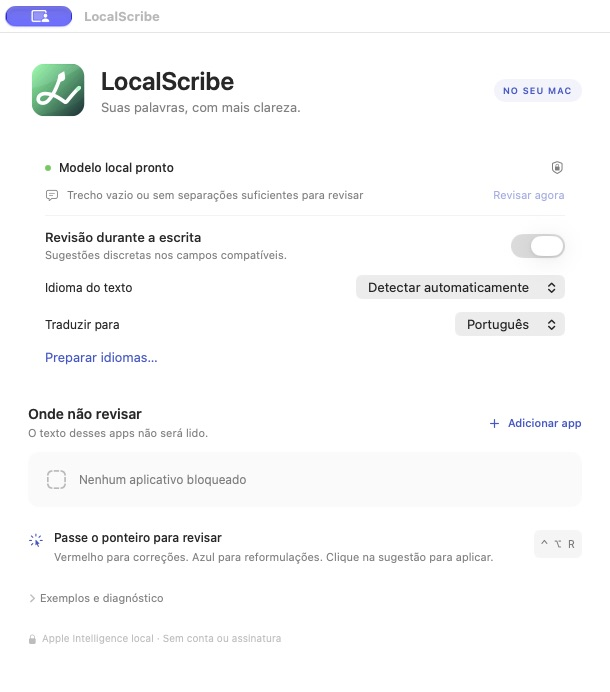

# LocalScribe

Assistente de escrita para macOS com Apple Intelligence local. Detecta o idioma do texto, mostra correções e sugestões junto ao campo de escrita e aplica somente a proposta que você aceitar. Sem conta do aplicativo, backend próprio ou assinatura.

**Versão atual: 0.7.6 · Apple Silicon · macOS 26.4 ou posterior.**

## Instalar

**[Baixar o instalador 0.7.6](downloads/LocalScribe-0.7.6-arm64.dmg.zip)**

Extraia o ZIP, abra o DMG e arraste o LocalScribe para Aplicativos. O ZIP preserva os metadados do ícone verde do arquivo; o volume montado também contém o ícone. O SHA-256 está em [downloads/SHA256SUMS](downloads/SHA256SUMS).

Na primeira abertura, autorize **LocalScribe** em Ajustes do Sistema → Privacidade e Segurança → Acessibilidade. O app fica na barra de menus. A distribuição atual usa assinatura ad hoc e ainda não tem assinatura Developer ID/notarização; consulte as [instruções de instalação](Support/LEIA-ME.txt).

O Mac precisa ser compatível com Apple Intelligence, com o modelo local habilitado e disponível. Idiomas de tradução podem exigir o download dos pacotes da Apple.

## Funcionalidades

- Idioma de origem automático, com escolha manual opcional.
- Ortografia rápida pelo dicionário do macOS e revisão local de gramática e estrutura.
- Sublinhados e cartões de palavra ou frase em campos que expõem as capacidades necessárias de Acessibilidade.
- Reformulação conservadora: mantém a ideia e confere a proposta completa antes de mostrá-la.
- Aplicação verificada no editor, preservando correções independentes e reutilizando a revisão da frase aceita.
- Tradução da sugestão sob demanda para o idioma configurado.
- Lista de aplicativos bloqueados, pausa e atalho **Control + Option + R**.
- Cache temporário por texto/campo e revisão por blocos para respeitar o orçamento do modelo.
- Ícone verde vetorial e marca monocromática na barra de menus, adaptada ao sistema.



## Compatibilidade atual

| Aplicativo/campo | Evidência disponível |
| --- | --- |
| WhatsApp no Chrome | Leitura, cartões e aplicações verificadas no compositor testado. |
| Slack desktop | Leitura, geometria e aplicações verificadas no compositor testado. |
| Teams desktop | Leitura, cartões e aplicações verificadas; proposta aceita reutilizada sem nova geração. |
| TextEdit | Integração nativa e aplicações exercitadas durante o desenvolvimento. |
| Safari, Firefox e outros campos | Base comum implementada; validação real ainda pendente. |

A compatibilidade depende do campo, das versões e das APIs que ele oferece. Campos protegidos e aplicativos bloqueados não são revisados. O modelo pode errar ou recusar certos trechos; nenhuma proposta é aplicada automaticamente. A cobertura detalhada está em [docs/INTEGRATION_ARCHITECTURE.md](docs/INTEGRATION_ARCHITECTURE.md).

## Compilar e testar

Requer Swift e Command Line Tools/SDK compatível com FoundationModels. O projeto não usa dependências de terceiros nem macros de geração.

```sh
./scripts/build-app.sh
open dist/LocalScribe.app
```

O build produz o app e os recursos de ícone em `dist/`, com assinatura ad hoc.

```sh
.build/release/WritingCoreChecks
dist/LocalScribe.app/Contents/MacOS/LocalScribe --diagnose
dist/LocalScribe.app/Contents/MacOS/LocalScribe --proposal-stability-smoke
```

Os testes do núcleo têm 62 verificações. O último comando usa o modelo local real para verificar propostas em inglês/português e reutilização da revisão; ele não escreve em um editor externo. Outros ensaios estão documentados em [docs/VALIDATION.md](docs/VALIDATION.md).

Para empacotar uma compilação já criada:

```sh
./scripts/package-dmg.sh
```

O script cria e verifica o DMG, os ícones do arquivo/volume e o ZIP que preserva os metadados Finder.

## Estrutura

```text
Sources/LocalScribe/  Interface, Acessibilidade e serviços locais da Apple
Sources/WritingCore/ Intervalos, propostas, segmentação, cache e políticas
Checks/              Regressões executáveis do núcleo
Fixtures/            Editores e textos sintéticos de teste
Support/             Info.plist, instruções e recursos do ícone
scripts/             Compilação, renderização vetorial e DMG
docs/                Especificação, planos, análises, evidências e validação
downloads/           Instalador atual e checksum
```

## Documentação

**[Índice completo](docs/README.md)** · [Especificação de referência](docs/CLONE_SPEC.md) · [Plano Apple Intelligence](docs/APPLE_INTELLIGENCE_PLAN.md) · [Implementação](docs/IMPLEMENTATION.md) · [Correção da revisão após aplicar](docs/PROPOSAL_STABILITY.md).

A pesquisa descreve comportamentos observados e marca o que continua desconhecido. O código e a identidade visual do LocalScribe são próprios; os índices de evidência não redistribuem implementação ou catálogos de recursos do produto estudado.
