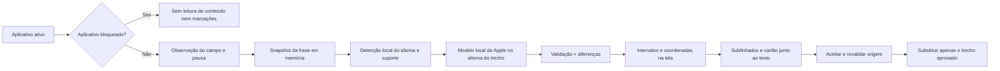

# Plano de viabilidade — revisão local de texto no macOS

Data da análise: 23/10/2026. Escopo: **revisar automaticamente enquanto a pessoa escreve em outros aplicativos, detectar o idioma do trecho e apresentar marcações e cartões de correção/reformulação junto ao texto**, conforme as referências visuais fornecidas pelo usuário. Detecção automática é o padrão; nenhuma língua fica fixada obrigatoriamente. Inclui bloqueio por aplicativo. Este documento planeja um produto independente a partir do recorte de correção de `CLONE_SPEC.md`; não implementa o aplicativo.

## 1. Decisão

**O motor local é viável e já foi exercitado neste Mac. A experiência automática com sublinhados é viável como arquitetura proposta, mas ainda depende de um protótipo de integração por editor.** A qualidade também precisa de validação: o teste do modelo encontrou sugestões indevidas e inconsistências.

Usar Swift, SwiftUI/AppKit, identificação local de idioma com Natural Language, `FoundationModels.SystemLanguageModel.default` para correções e alternativas e as APIs públicas de Acessibilidade. A Apple documenta esse modelo como executado no dispositivo; o acesso local funciona sem conta do aplicativo, chave de API ou cobrança por inferência. Não é necessário criar um serviço de autenticação ou assinatura. [A1, A2, A14]

O aplicativo terá interface e lógica próprias. O modelo gera candidatos; o aplicativo acompanha o campo em edição, calcula alterações, localiza os trechos na tela, desenha os sublinhados e aplica apenas o que a pessoa aceitar. Apple Intelligence é o motor linguístico; ela não fornece por si só a interface global sobre outros aplicativos. [A2, A5, A8]

**Parecer:** iniciar pelo protótipo de texto + coordenadas + sublinhado + aceitação em TextEdit e Chrome. Não considerar o MVP concluído com apenas revisão manual em uma janela. Ainda não há evidência para prometer qualidade equivalente ao Grammarly, correção instantânea ou compatibilidade universal.

## 2. Evidência neste Mac

As consultas não alteraram configurações. Os testes de geração usaram apenas três frases artificiais, nenhuma informação pessoal. Não houve captura de tráfego ou teste com a rede desligada; a execução local é sustentada pelo modelo explicitamente utilizado e pela documentação da Apple.

| ID | Verificação | Resultado observado |
|---|---|---|
| L1 | `sw_vers`, `uname -m` | macOS 27.0.1, build 26A434, `arm64` |
| L2 | `xcrun swift --version` | Swift 6.4; SDK local contém `FoundationModels`, AppKit e ApplicationServices |
| L3 | `SystemLanguageModel.default.availability` | `available` |
| L4 | `contextSize` | 4096 tokens neste modelo |
| L5 | `supportsLocale` | `true` para `en-GB`, `en-US`, `pt-BR` e `pt-PT` |
| L6 | `LanguageModelSession.respond`, com esquema estruturado dinâmico | Três respostas completas de correção e alternativas |
| L7 | Compilação inicial com `@Generable`/`@Guide` pelo Command Line Tools | Falhou por ausência do plugin `FoundationModelsMacros`; a versão com `DynamicGenerationSchema` compilou e executou |

Suporte de locale inclui possíveis fallbacks: `true` não comprova precisão de cada variante regional. A lista precisa ser consultada em execução. [A3]

### Testes de geração e suas limitações

| Caso | Entrada | Saída e avaliação |
|---|---|---|
| P1 — inglês com erros | `She go to school every days. I has an important meeting tomorrow, and I would like your advise about my presentation.` | O texto final corrigiu `go → goes`, `days → day`, `has → have` e `advise → advice`. A lista estruturada de problemas omitiu `advise → advice`: não correspondeu integralmente ao texto final. |
| P2 — inglês correto | `The meeting starts at nine tomorrow. Please bring the report.` | O texto final permaneceu igual, mas a lista marcou `at nine → at nine o'clock` como erro. É um falso positivo neste contexto. As duas alternativas eram iguais. |
| P3 — português | `Os documento foi enviado ontem. Preciso que você verifica os dados.` | Produziu `O documento foi enviado ontem. Preciso que você verifique os dados.` A frase resultante é gramatical, mas a primeira construção original admite intenção singular ou plural; o modelo escolheu uma interpretação. As alternativas também eram iguais. |

Tempos observados por chamada, incluindo texto corrigido, explicações e duas alternativas: **13,69 s; 4,11 s; 4,83 s**, nessa ordem. São três medições isoladas, sem controle de carga ou estudo de inicialização. Não são média, percentil ou garantia de desempenho.

O teste prova acesso funcional ao modelo e capacidade básica de reformulação. Também demonstra por que a resposta estruturada não deve ser tratada como uma avaliação gramatical infalível. O esquema garante forma, não verdade linguística. [A4]

O código original do experimento está em [apple-intelligence-writing-probe.swift](experiments/apple-intelligence-writing-probe.swift). Ele é uma prova técnica, não o motor final.

### Referências visuais fornecidas pelo usuário

| ID | Evidência visível | Requisito extraído e limite |
|---|---|---|
| V1 | [Imagem 1](/var/folders/ym/2qh39lkx1z7gkd9npmd69w0w0000gn/T/codex-clipboard-e8af6c58-a93f-4619-833e-70daeb7ef252.png): cartão sobre uma frase em português; partes removidas em vermelho e riscadas, inserções em azul; ação Ignorar | Cartão com comparação no contexto da frase, compatível com uma reformulação; a rota interna exata é UNKNOWN. O cabeçalho comercial é visível na referência, mas não faz parte do produto proposto. O clique de aceitação e sua consequência não foram observados nessa imagem. |
| V2 | [Imagem 2](/var/folders/ym/2qh39lkx1z7gkd9npmd69w0w0000gn/T/codex-clipboard-769a4c5b-e1c6-4b24-b3e2-ef63899924be.png): `ola` marcado na frase `ola eu sou tesx`; cartão próximo oferece `Olá`, com Dismiss | Correção pontual na posição da palavra, proposta clicável e opção de ignorar, sem sair do campo. A imagem não prova como o idioma foi reconhecido nem que `tesx` deva ser alterado. |

As imagens mostram propostas em português apesar de alguns rótulos da interface estarem em inglês. A detecção automática é um requisito explícito do usuário; o algoritmo interno do produto observado permanece UNKNOWN. Usar essas referências para definir comportamento, mantendo textos de interface, aparência e identidade próprios, sem transplantar assets.

## 3. Experiência da primeira versão

1. Após a configuração inicial, a pessoa escreve normalmente em um campo compatível de um aplicativo não bloqueado, sem selecionar o texto ou abrir outra janela.
2. O aplicativo acompanha somente o campo ativo e agenda a análise da frase/parágrafo alterado após uma pausa. Valor inicial proposto: cerca de 800 ms; deve ser ajustado por medição, não é uma garantia de latência.
3. O aplicativo identifica o idioma da frase com contexto próximo, confirma suporte do modelo e solicita a correção **nesse idioma**, sem traduzir. A escolha não depende da língua da interface, do macOS ou do aplicativo de origem.
4. O modelo local retorna uma proposta de correção; o aplicativo valida a revisão de origem, o idioma de saída e os intervalos alterados.
5. Os trechos com propostas de correção recebem **sublinhado ondulado vermelho no próprio local onde estão sendo escritos**. Pode haver um realce suave do trecho ativo, sem modificar a cor ou a formatação armazenada no documento. A cor vermelha identifica uma correção proposta, não uma certeza matemática de erro.
6. Ao passar o ponteiro sobre um trecho marcado, um pequeno cartão próximo apresenta original, substituição, explicação curta quando disponível e **Ignorar**. Clicar na substituição aplica a correção; oferecer também ação Aceitar e equivalente pelo teclado. O clique em um indicador discreto pode oferecer outra forma de abrir a lista.
7. Aceitar aplica somente a alteração escolhida, remove a marca correspondente e agenda uma nova revisão da frase afetada. Não mudar o texto automaticamente sem aceitação.
8. Uma candidata de **melhoria opcional da frase** pode aparecer automaticamente quando a frase estiver estável, com prioridade inferior às correções e sem obrigação de produzir uma reescrita. **Sugerir alternativas**, no cartão ou em um indicador do campo, solicita até duas opções adicionais no mesmo idioma. Elas usam comparação de alterações e só são aplicadas após escolha explícita. O tipo de cartão de V1 faz parte do MVP, sem exigir geração de alternativas a cada tecla. Gatilho e cadência são decisões propostas do MVP, ainda sujeitas a medição.
9. Continuar digitando invalida as propostas afetadas imediatamente; rolar ou mover a janela reposiciona as marcas. Trocar de campo/aplicativo oculta as marcas anteriores. Mudar a língua escrita exige nova detecção por trecho, sem alterar configurações.

O atalho para revisar uma seleção e o botão Copiar continuam úteis como recursos complementares. Eles **não substituem** a integração automática exigida neste MVP. Quando um editor não puder ser integrado, indicar a limitação em vez de desenhar marcas aproximadas.

### Telas e controles

| Superfície | Conteúdo |
|---|---|
| Menu na barra do macOS | Pausar/retomar revisão, Desativar neste aplicativo, Revisar seleção, Configurações, Sair |
| Configurações simples | Idioma: Automático por padrão, com escolha manual opcional; Aplicativos bloqueados; atalho opcional; estado da permissão de Acessibilidade e do modelo |
| Aplicativos bloqueados | Lista de apps com nome, Adicionar aplicativo e Remover; estado vazio explicado |
| Camada de marcações | Sublinhados vermelhos alinhados aos trechos visíveis; não rouba o foco nem bloqueia a digitação |
| Cartão de correção pontual | Tipo da proposta e substituição clicável em destaque, como `ola → Olá`; Ignorar e ação equivalente pelo teclado |
| Cartão de reformulação | Frase no contexto; remoções riscadas em vermelho e inserções em azul; Aceitar e Ignorar; sem rótulo Pro, cota ou link comercial |
| Indicador do campo | Estado discreto de análise e quantidade de propostas; acesso às sugestões pelo teclado |
| Alternativas | Até duas opções diferentes, comparação com a frase original e aceitação explícita |
| Sem alterações | “Nenhuma alteração sugerida nesta revisão”, sem garantir ausência absoluta de erros |
| Estado indisponível | Motivo concreto e ação possível: conceder Acessibilidade, aguardar modelo ou selecionar texto menor |

Não incluir login, planos, paywall, contadores comerciais, ativação de módulos extras, chat, histórico de documentos, ditado ou reuniões. Não reproduzir a marca ou os recursos gráficos do aplicativo analisado. O recorte funcional vem de `CLONE_SPEC.md`, BB-001–005, SM-003 e WR-001/005/006/017. No estudo anterior foram observadas marcações e sugestões no Chrome; a técnica interna exata de desenho do Grammarly permanece UNKNOWN. A arquitetura abaixo é uma proposta independente.

### Idioma automático como padrão

**Idioma de revisão = Automático** na primeira execução. A pessoa pode escrever em português e depois inglês no mesmo aplicativo, sem trocar uma configuração. Detectar por frase/trecho com apoio do parágrafo próximo, evitando prender o documento inteiro à primeira língua encontrada. Correções e alternativas permanecem no idioma daquele trecho. Interface e explicações podem ficar em português e são independentes da língua corrigida.

Proposta de fluxo: `texto alterado → identificação local do idioma → verificação de suporte → correção no idioma identificado → validação da resposta → marcação`. `NLLanguageRecognizer`, do framework Natural Language da Apple, fornece uma língua provável e hipóteses com probabilidades. Essa etapa faz o encaminhamento local; o modelo Apple Intelligence continua responsável pelas propostas linguísticas. Não é um serviço de tradução nem um segundo corretor. A qualidade dessa combinação ainda não foi testada no novo app. [A14]

- Consultar `supportsLocale` para o idioma identificado, em vez de usar implicitamente o locale atual do sistema. O suporte do reconhecimento de idioma e o suporte do modelo são coisas distintas. Não limitar o detector a inglês/português de maneira que force um texto de outra língua a caber nessas opções. [A3]
- A disponibilidade depende dos idiomas suportados pelo modelo instalado; validar primeiro português e inglês, com avaliação específica antes de anunciar qualidade em outros idiomas. Detecção automática não equivale a suporte universal.
- Para texto curto, com erros ou ambíguo, usar somente contexto próximo do mesmo campo. Se ainda não houver evidência suficiente, aguardar mais texto ou oferecer escolha opcional de idioma no cartão. Não assumir inglês como fallback e não mostrar um erro baseado numa língua incerta.
- Não exigir um número mínimo fixo de palavras: um termo curto pode receber proposta quando o contexto for suficiente. Exemplo de aceitação: detectar português em `ola eu sou tesx` e oferecer `Olá` sem inventar automaticamente uma correção para um possível nome como `tesx`.
- Em texto misto, identificar unidades menores quando houver contexto suficiente e preservar cada língua. Uma frase em português com termo em inglês, nomes, código ou URLs não deve ser traduzida nem marcada inteira como errada. Se o trecho misto não puder ser tratado com segurança, suprimir a proposta incerta e indicar a limitação quando a pessoa abrir a revisão.
- Não apresentar uma variante regional como detectada apenas porque a língua foi reconhecida. Preferências opcionais, como inglês UK/US ou português BR/PT, refinam a correção da respectiva língua; não convertem textos de outra língua para ela. Sem preferência suficiente, evitar mudanças que sejam apenas regionalismos.
- A configuração manual é uma exceção opcional: `Automático`, `Português`, `English` e demais opções validadas. No modo manual, divergência com o texto deve gerar indicação e opção de voltar ao automático, nunca tradução silenciosa.
- Trocar o idioma detectado invalida resultados/cache incompatíveis; incluir idioma resolvido, modo e variante na identidade da análise. Isolar contexto entre campos e aplicativos para não carregar a língua da mensagem anterior.

Os limiares de decisão devem ser calibrados com exemplos reais e reservados. Probabilidade do detector é uma pista de idioma, não uma medida de correção gramatical. O resultado do modelo também precisa ser verificado quanto à preservação de idioma; se ele traduzir ou mudar a língua indevidamente, descartar a proposta. [A3, A14]

### Apresentação dos dois tipos de sugestão

**Correção pontual (V2):** marca vermelha sob o trecho, cartão pequeno ancorado à palavra, título próprio como “Ortografia”, substituição em destaque e Ignorar. Clicar na proposta aceita aquela ocorrência. Não criar destaque para palavras desconhecidas somente por não constarem de um vocabulário comum.

**Melhoria de frase (V1):** cartão ancorado à frase, título próprio como “Sugestão de escrita” e comparação no contexto, com partes removidas riscadas em vermelho e adicionadas em azul. A frase original pode estar correta; classificar a reformulação como opcional e dar a ela um indicador visual distinto, sem marcar a frase inteira como erro gramatical. O diff dentro do cartão pode usar vermelho para remoções mesmo em uma sugestão de estilo.

Nos dois casos, manter o cartão na área visível, movendo acima/abaixo conforme o espaço. Permitir ir do trecho ao cartão sem fechá-lo imediatamente; fechar ao sair da interação, pressionar Escape ou mudar de campo. Não roubar o foco durante digitação. Cor deve ser acompanhada de texto e sinais como risco/adição, permitindo uso por teclado e sem depender só da distinção de cores. São requisitos novos de interação a validar, não ações comprovadas pelas capturas estáticas.

### Decisão entre correção pontual e cartão de frase

O estudo [GRAMMARLY_SUGGESTION_ANALYSIS.md](GRAMMARLY_SUGGESTION_ANALYSIS.md) reconcilia REA, observações e imagens. O recurso `Suggestion bundles`, confirmado em R-WR do levantamento, descreve agrupamento de correções na mesma frase. Portanto, **cartão com frase inteira não equivale necessariamente a reescrita**, e corrigir várias palavras não equivale necessariamente a uma melhoria de estilo.

No MVP, separar três decisões: **intenção** (correção ou melhoria opcional), **alvo** (ocorrência, trecho, grupo relacionado ou frase) e **contexto exibido** (compacto ou frase com diff). O algoritmo interno do Grammarly que toma essas decisões continua UNKNOWN; as regras abaixo são independentes:

- Detectar idioma e obter contexto da frase antes da análise, mesmo quando o resultado for uma correção de uma palavra.
- Gerar correções mínimas e melhorias opcionais em caminhos distintos. Não deduzir intenção somente pela quantidade de palavras alteradas; permitir ausência de melhorias.
- Calcular os intervalos pelo diff no aplicativo. Para uma ocorrência localizada, usar cartão compacto; para alterações distribuídas/dependentes ou reformulação, mostrar a frase com comparação. O contexto mostrado pode ser maior que o alvo substituído.
- Manter separadas correções independentes. Quando mudanças dependerem umas das outras, representá-las como grupo e aceitar o grupo inteiro; a política de dependências precisa de testes próprios.
- Priorizar correções sobre reformulações conflitantes do mesmo texto; após aceitar uma delas, invalidar propostas sobrepostas baseadas na revisão anterior.
- No cartão de frase, preservar e distinguir as partes inalteradas. Aceitar altera somente o alvo aprovado e não substitui o campo inteiro por conveniência.

Exemplos de aceitação: `ola → Olá` é pontual; `I has → I have` continua sendo correção gramatical apesar do contexto com duas palavras; uma alteração de clareza pode modificar apenas uma expressão; várias mudanças de concordância relacionadas podem exigir cartão de frase sem serem uma reescrita estilística. O MVP precisa passar por esses casos e não classificar apenas por extensão do texto.

### Aplicativos bloqueados

Incluir no MVP uma lista local em **Configurações → Aplicativos bloqueados**, para escolher onde o assistente não deve atuar. O bloqueio desativa a revisão naquele aplicativo inteiro, em todas as suas janelas e campos.

- **Adicionar aplicativo:** selecionar um aplicativo instalado; exibir seu nome na lista e impedir entradas duplicadas.
- **Desativar neste aplicativo:** ação rápida no menu da barra, identificando explicitamente o último aplicativo de escrita ativo, antes de o menu/configurações do assistente receber o foco.
- **Remover:** retirar um app da lista permite novas revisões quando ele estiver ativo, desde que a pausa global e as demais condições permitam. Não restaurar propostas antigas.
- A lista começa vazia e permanece salva entre reinicializações. Nome é apresentação; a regra usa a identidade estável do aplicativo, como seu bundle identifier, para evitar confundir apps com nomes iguais e acompanhar atualizações que preservem essa identidade. Se não for possível resolver a identidade, explicar a limitação em vez de gravar uma regra ambígua.
- Conferir o bloqueio **antes de ler o conteúdo do campo**, ao trocar de aplicativo, antes de iniciar uma análise e novamente antes de mostrar ou aplicar uma proposta. A regra também vale para a revisão manual por atalho e para um eventual adaptador de navegador.
- Ao bloquear o app ativo, interromper a observação de conteúdo, remover imediatamente sublinhados/cartões, limpar snapshots/cache associados e cancelar trabalhos quando possível. Uma chamada já em execução pode levar tempo para encerrar; sua resposta deve ser descartada e não pode gerar marcas ou alterações. Não iniciar novas chamadas desse aplicativo.
- Mostrar estado discreto de **Revisão desativada neste aplicativo**, com acesso à lista para reativar. Retomar a pausa global não remove bloqueios individuais.

Bloquear Chrome ou Safari desativa a revisão em todo o navegador. Bloqueio por site é uma extensão futura de escopo e não exige acesso ao histórico ou à URL na primeira versão. A lista de exclusões foi observada no produto estudado (`CLONE_SPEC.md`, BB-007); a política descrita aqui é um requisito novo, não uma reprodução de comportamento interno confirmado.

## 4. Arquitetura proposta

| Componente proposto | Responsabilidade |
|---|---|
| `AppExclusionPolicy` | Resolver a identidade do app e conferir bloqueios antes da leitura, análise, exibição e escrita; invalidar trabalhos ao bloquear |
| `FocusedEditorObserver` | Identificar o campo ativo e acompanhar mudanças, foco, rolagem e ciclo de vida por Acessibilidade |
| `AnalysisScheduler` | Aguardar pausa, agrupar mudanças, cancelar/descartar trabalho antigo e limitar uma análise ativa |
| `TextSnapshot` | Vincular texto, frase e intervalos a uma revisão específica do campo |
| `LanguageResolver` | Detectar idioma por trecho, lidar com ambiguidade e texto misto e resolver variante/preferência sem tradução |
| `ReviewEngine` | Verificar disponibilidade/locale; criar sessão curta; pedir correção mínima ou alternativas |
| `DiffValidator` | Calcular posições, conferir consistência e gerar alterações aplicáveis |
| `TextGeometryProvider` | Converter intervalos do texto em retângulos visíveis no editor |
| `UnderlineOverlay` | Desenhar linhas vermelhas e atualizar posição/visibilidade sem tomar o foco |
| `SuggestionCard` | Renderizar correção pontual ou comparação de frase junto ao trecho e permitir aceitação/recusa por mouse ou teclado |
| `TextReplacement` | Revalidar origem, consultar capacidade de escrita e aplicar somente a alteração escolhida |
| `Preferences` | Persistir modo de idioma (Automático como padrão), exceção manual/variantes opcionais, pausa, aplicativos bloqueados e atalho opcional localmente |

### Observação, desenho e substituição entre aplicativos

Usar `AXUIElement` para localizar o campo focado e ler o contexto necessário; `AXObserver` e notificações de alteração de valor/foco para acompanhar edições. Eventos disponíveis variam por aplicativo; um adaptador pode precisar de verificação periódica limitada ao campo ativo quando não houver notificação confiável. O processo do novo aplicativo precisará da permissão de **Acessibilidade** do macOS. Isso é uma permissão do sistema, não login ou ativação de recurso pago. [A5, A9]

Para localizar a palavra, consultar os recursos de geometria oferecidos pelo editor, como `AXBoundsForRange`, e o intervalo de texto visível quando disponível. Essas APIs descrevem posições de texto; sua existência não garante implementação completa em todos os aplicativos. Dividir intervalos que atravessem linhas e obter retângulos por segmento, evitando um único sublinhado através de linhas diferentes. Converter coordenadas entre tela e janelas, incluindo múltiplos monitores e escalas de exibição. [A8, A10]

Desenhar os sublinhados em uma janela transparente própria, alinhada e recortada ao campo visível do aplicativo alvo. A camada decorativa deixa os eventos de mouse passarem. O cartão é uma superfície interativa separada, preferencialmente um painel que não ative o aplicativo desnecessariamente. A detecção de ponteiro sobre uma marca deve ser implementada separadamente, sem transformar a camada inteira em um bloqueador de cliques do editor. São capacidades públicas de AppKit; a combinação deve ser testada como protótipo. [A11, A12]

Recalcular geometria em rolagem, redimensionamento, mudança de zoom e quebra de linha. Ocultar imediatamente as marcas quando o aplicativo perde o foco, é minimizado, muda de Space, fica encoberto por outra janela ou perde correspondência com o texto. O rastreamento de visibilidade/oclusão e tela cheia é uma parte obrigatória do protótipo: não assumir que uma janela flutuante acompanha corretamente outra janela por si só.

Guardar em memória a identidade do aplicativo/elemento, o intervalo e a revisão do texto. Antes de Aceitar, obter novamente o estado relevante. Se o trecho ou destino mudou, invalidar a proposta. Consultar a capacidade de escrita e substituir somente o intervalo aprovado por um mecanismo validado para aquele editor. Não atribuir o campo inteiro para aplicar uma correção. Restaurar foco/caret quando necessário e testar desfazer no aplicativo de origem. A conferência reduz corridas, mas não cria uma transação atômica entre processos. [A5]

Campos protegidos devem ser excluídos. Não usar captura de tela/OCR nem interceptação de todas as teclas como mecanismo padrão. Campo vazio, somente leitura, aplicativo encerrado ou elemento inacessível deve produzir um estado compreensível. Pausar deve interromper observação de conteúdo e remover todas as marcas.

**Compatibilidade ainda UNKNOWN:** observação, geometria, escrita, formatação e desfazer do novo aplicativo em Chrome, Safari, TextEdit, Word, Pages ou editores Electron. O teste anterior do Grammarly no Chrome não comprova essa integração independente. Alvos iniciais: TextEdit com texto simples e Chrome com `textarea`, inclusive o cenário iLoveNote do estudo anterior. Validar ambos antes de ampliar a lista.

Se o Chrome não oferecer geometria/atualizações suficientes por Acessibilidade, planejar um adaptador via extensão: acompanhar o editor da página e desenhar marcações pela camada web, mantendo o motor Apple no componente nativo local. É uma alternativa de integração a investigar, não uma dependência já necessária ou uma implementação concluída. Para `textarea`, não se pode estilizar substrings do valor como HTML: será necessário espelho visual alinhado ou mecanismo equivalente. Em `contenteditable`, preservar a estrutura do editor em vez de inserir elementos indiscriminadamente. Safari tem APIs oficiais para ler/modificar páginas e comunicar com um app nativo, mas suporte concreto a cada navegador exige projeto e validação próprios. [A13]

`NSWritingToolsCoordinator` serve para integrar as ferramentas de escrita do sistema a uma view do próprio aplicativo. Ele não substitui a camada de captura em outros aplicativos. Para controlar a interface, idioma, resposta e escolha explícita do modelo local, a proposta é usar `FoundationModels` diretamente. [A6]

### Motor de revisão e validação

- Detectar o idioma primeiro e pedir texto corrigido nesse idioma, com alterações mínimas e preservação de significado, fatos, nomes, números, URLs e quebras de linha. Não usar o idioma das instruções ou da interface como idioma obrigatório de saída. A avaliação de uma melhoria opcional é separada e secundária, somente para frase estável; mais alternativas são solicitadas pela pessoa. Ambas preservam a língua do trecho e podem não produzir uma proposta útil.
- Calcular as alterações entre original e resultado no aplicativo. Não confiar em posições ou em uma lista de erros produzida pelo modelo. Isso resolve a inconsistência estrutural encontrada em P1/P2, mas não elimina erros linguísticos do modelo.
- Se o texto final for igual ao original, a lista de correções é vazia. Preferências opcionais de estilo ficam em Alternativas, sem rótulo de erro.
- Quando houver explicação gerada, vinculá-la a uma diferença real e rejeitar trechos que não existam na entrada. Pode-se adiar explicações livres para manter a primeira revisão mais rápida e consistente.
- Tratar o conteúdo do campo como dados. Não executar instruções encontradas nele e não fornecer ferramentas de rede ou ações do sistema ao modelo.
- Validar intervalos Unicode, palavras repetidas, emojis, acentos combinantes, quebras de linha e alterações sobrepostas. Converter explicitamente entre índices Swift e os intervalos usados pela integração, sem usar contagem de bytes como posição de texto.
- Deduplicar alternativas e remover opções iguais ao texto base. “Até duas” é preferível a forçar duas: o teste mostrou que a obrigação de preencher a lista produz duplicatas.
- Quando a correção depender de resolver ambiguidade que altera quantidade ou sentido, apresentar a proposta para decisão da pessoa. Não afirmar que a intenção foi preservada com certeza.

### Tamanho, desempenho e execução local

O orçamento inclui instruções, esquema, entrada e saída; neste Mac o limite informado é 4096 tokens. Criar uma sessão nova por revisão e reservar espaço para a resposta. Analisar a frase/parágrafo alterado com contexto curto, usando contagem de tokens quando disponível. Não reenviar o documento inteiro a cada alteração. Trechos que excedam o orçamento precisam de segmentação ou indicação de limite. [A7]

Manter uma tarefa ativa de cada vez; se a pessoa continuar digitando, manter somente a revisão mais recente pendente. Cancelar quando possível e sempre descartar respostas desatualizadas. Usar cache em memória por texto/idioma/configuração para não repetir análises idênticas. Não aplicar saída parcial de streaming. Medir primeira chamada e chamadas subsequentes separadamente. Preaquecimento pode ser avaliado depois de medir memória e energia.

**Transparente não significa instantâneo:** os testes com correção e alternativas juntas levaram de 4,11 a 13,69 segundos. O caminho otimizado de correção isolada ainda não foi medido. O MVP deve analisar após pausas e desenhar as propostas quando a revisão válida terminar; não prometer sublinhado a cada tecla. Um corretor ortográfico local do macOS poderia acelerar erros simples futuramente, mas seria um segundo motor, diferente de Apple Intelligence, e não faz parte da premissa atual.

### Estados da integração automática

`Pausado → aguardando campo → observando → aguardando pausa → identificando idioma → analisando(revisão N, idioma) → marcas válidas → cartão pontual ou de frase aberto → aplicando → observando`.

Identificação pode levar a `idioma incerto` (aguardar contexto ou oferecer escolha) ou `idioma sem suporte` (sem proposta nessa unidade). Uma nova língua no mesmo campo cria análise própria; não fica fixada à análise anterior.

Qualquer edição gera uma nova revisão e invalida as marcas afetadas; resultado de uma revisão anterior é descartado. Perder foco, visibilidade ou geometria confiável oculta as marcas. Permissão revogada, modelo indisponível ou editor incompatível levam a um estado explícito de indisponibilidade. Ignorar suprime aquela proposta para a revisão atual e não cria uma regra persistente sem uma configuração futura específica.

`Aplicativo bloqueado` é um estado adicional, consultado antes de observar o campo. Adicionar o app ativo à lista leva imediatamente a esse estado e invalida qualquer revisão pendente. Remover o bloqueio retorna a `aguardando campo`, respeitando a pausa global e exigindo uma captura nova.

Selecionar explicitamente `SystemLanguageModel`; não usar fallback automático para Private Cloud Compute, ChatGPT ou outro provedor. O aplicativo não precisa de backend, protocolo HTTP próprio nem chaves. O macOS pode precisar de internet para obter inicialmente os modelos e atualizações; a promessa de revisão offline pressupõe o modelo pronto. Um teste real sem rede ainda é necessário. [A1, A2]

## 5. Configuração, dados e falhas

Persistir somente `languageMode` (padrão `automatic`), `manualWritingLocale` opcional, `preferredVariants` opcionais por língua, estado de pausa, atalho opcional e `blockedApplications` em `UserDefaults`, no domínio próprio do aplicativo. A língua detectada por trecho é transitória e não altera a preferência global nem cria histórico. Cada entrada de bloqueio contém identidade do aplicativo e nome de exibição; não contém textos escritos nele. O caminho físico varia com sandbox/distribuição e será confirmado no protótipo. Permissão de Acessibilidade é administrada pelo macOS, não por um booleano que o app possa conceder a si mesmo.

Textos, propostas, snapshots, cache e sessões ficam apenas em memória pelo tempo necessário à revisão do campo ativo, sendo descartados ao encerrar o acompanhamento. Não salvar histórico, transcrições, conteúdo em logs ou análise de uso por padrão. O botão Copiar coloca deliberadamente o resultado na área de transferência, um recurso compartilhado do sistema. A configuração inicial deve explicar que o campo ativo será analisado automaticamente no dispositivo e como pausar.

| Situação | Comportamento proposto |
|---|---|
| Modelo indisponível ou ainda não pronto | Mostrar motivo e permitir verificar novamente; não cobrar nem encaminhar o texto à nuvem |
| Idioma incerto | Aguardar contexto ou permitir escolha opcional; não produzir marca baseada em hipótese fraca |
| Idioma identificado sem suporte | Indicar limite de suporte; não forçar outra língua nem traduzir |
| Modelo devolve tradução/muda a língua | Descartar a proposta e permitir nova tentativa |
| Permissão ausente/revogada | Explicar Acessibilidade e oferecer acesso às configurações do sistema |
| Aplicativo bloqueado | Não ler conteúdo nem iniciar análise; remover marcas/cartões e descartar resultados pendentes; indicar desativação |
| App já está na lista | Manter uma única entrada e indicar que já está bloqueado |
| Campo vazio ou só espaços | Não chamar o modelo nem mostrar marcas |
| Trecho grande | Analisar unidade menor com contexto limitado; sinalizar caso não caiba |
| Resposta inválida, truncada ou impossível de alinhar | Descartar como correção aplicável e oferecer nova tentativa |
| Recusa/guardrail ou erro do modelo | Informar falha sem inventar resultado; permitir cancelar ou tentar outra seleção |
| Origem editada durante a análise | Invalidar resultado antigo e agendar a revisão mais recente |
| Geometria ausente/desatualizada | Ocultar marcas; nunca desenhar um sublinhado em posição estimada |
| Campo inacessível/não gravável | Indicar limite de compatibilidade; nunca sobrescrever outro campo |
| Rolagem, outra janela por cima ou troca de aplicativo | Reposicionar somente com geometria válida; ocultar enquanto não for possível |
| Timeout, pressão de recursos ou pedido cancelado | Encerrar o estado de espera; não aplicar resposta atrasada |

## 6. Etapas e critérios para avançar

| Etapa | Entrega verificável | Critério de conclusão |
|---|---|---|
| 1 — prova da integração visual | Detectar campo e mudanças; desenhar uma marca de teste com intervalo conhecido, sem depender do modelo | Sublinhado alinhado em TextEdit simples e Chrome `textarea`, inclusive rolagem, quebra de linha e movimento da janela; não bloquear escrita/cliques |
| 2 — correção automática multilíngue local | Detecção de idioma, modelo, agendamento após pausa, diferenças e controle de revisão | Sem selecionar, usar atalho ou escolher idioma obrigatoriamente; alternar português/inglês no mesmo campo; só aparecem marcas de resultados atuais, na língua de origem |
| 3 — interação junto ao texto | Cartão pontual como V2, cartão de frase com diff como V1, Aceitar/Ignorar, alternativas e teclado | Substituir só a ocorrência/frase escolhida, preservar foco, idioma e texto restante; validar desfazer e recusar proposta antiga |
| 4 — produto mínimo e validação | Automático como padrão, exceção manual opcional, pausa, apps bloqueados, erros, qualidade, desempenho e teste offline | Fluxo completo sem login; bloqueios persistentes e aplicados antes da leitura; editores/idiomas validados documentados; sem defeito conhecido de escrita no destino incorreto ou marca sobre texto errado |

A prova visual vem primeiro porque o modelo local já foi exercitado e a maior incerteza adicional está na integração. Se um alvo falhar, avaliar um adaptador específico antes de prometer suporte. Um painel manual isolado não satisfaz os critérios acima.

Avaliação inicial proposta: pelo menos 100 casos curtos em inglês e 100 em português, incluindo frases corretas, erros claros, variantes regionais, termos próprios e mensagens informais; acrescentar casos de texto curto/ambíguo, troca de língua, conteúdo misto e idiomas sem suporte. Avaliar detecção e correção separadamente. Esses números são uma proposta de cobertura, não evidência de qualidade já atingida.

Registrar precisão das alterações, falsos positivos em frases corretas, erros não detectados, preservação de significado e números, alternativas úteis/distintas e tempo até o sublinhado após uma pausa. Qualidade deve ser avaliada por exemplos reservados, sem ajustar o prompt apenas às três frases deste experimento. Testar também digitação contínua, edição antes/dentro de uma marca, palavras repetidas, Unicode, múltiplas linhas, rolagem, zoom, monitores, oclusão, tela cheia, perda de foco, fechamento do aplicativo de origem, falta de permissão e desfazer.

**Cenário obrigatório de demonstração:** digitar `She go to school every days.` em um alvo suportado; após análise válida, marcar os trechos correspondentes a `go → goes` e `days → day`; abrir a proposta no local, aceitar apenas a primeira, manter o restante do documento intacto e reposicionar/remover corretamente as marcas após nova edição. Trata-se de um critério futuro, não de um teste já executado do novo app.

**Aceitação das referências e do idioma automático:** com configuração inicial Automático, digitar `ola eu sou tesx`; detectar português pelo contexto, marcar `ola`, mostrar `Olá` no cartão e aceitar somente essa ocorrência sem alterar `tesx` por suposição. Em seguida, escrever uma frase em inglês no mesmo campo sem tocar na configuração e receber propostas em inglês. Abrir também uma reformulação de frase em português com remoções/inserções destacadas como em V1, identificada como melhoria opcional. Verificar que o idioma da interface não interfere na língua das propostas, que uma palavra isolada ambígua não gera mudança de língua arbitrária e que nenhum cartão contém cota, selo Pro ou cobrança. Esses fluxos completos ainda não foram implementados ou testados.

**Aceitação da lista de bloqueio:** bloquear o aplicativo A enquanto há análise pendente remove sua interface e impede uso da resposta atrasada; o aplicativo B não bloqueado continua funcionando. Verificar ausência de novas leituras de conteúdo e análises em A, inclusive pelo atalho; reiniciar o assistente preserva a regra. Remover A permite uma revisão nova. Testar também entradas duplicadas, apps com nomes iguais, troca de foco ao abrir o menu e retomada da pausa global sem remover exclusões. Essas verificações pertencem à implementação futura.

**Condição para continuar:** a integração aplica de forma segura nos editores prioritários e o motor passa na avaliação linguística acordada. Se o modelo local não atingir qualidade suficiente, reduzir os idiomas/casos anunciados ou manter o resultado como proposta assistida; não introduzir serviço pago silenciosamente.

## 7. Questões ainda não confirmadas

- Precisão e cobertura real de gramática, pontuação, ortografia e variante regional fora dos três testes.
- Qualidade e limiares da identificação automática, reconhecimento com erros, texto misto e preservação da língua na resposta: fluxo ainda não exercitado. Os três testes anteriores usavam locale explícito.
- Quanto a separação entre correção e alternativas melhora qualidade e tempo: é uma decisão proposta, ainda não testada.
- Regra original de categoria, agrupamento, alvo e escolha de cartão; os recursos e as imagens não recuperam a decisão interna. O encaminhamento independente do MVP também precisa de validação, conforme `GRAMMARLY_SUGGESTION_ANALYSIS.md`.
- Observação automática, coordenadas, sublinhados, cartão, oclusão, formatação e desfazer de cada editor externo; o novo app ainda não foi implementado.
- Comportamento offline medido, consumo de memória/energia e latência sob carga.
- Distribuição assinada, sandbox e requisitos de empacotamento da integração: validar antes de escolher o canal de distribuição.
- Qualidade após atualizações do modelo do macOS. A Apple atualiza o modelo com o sistema; será necessário repetir a avaliação. [A2]

Nada disso exige login ou contratação de funcionalidades extras no produto proposto. Requisitos do sistema e permissão de Acessibilidade continuam existindo.

## 8. Fontes

- A1 — Apple: [Code along with the Foundation Models framework](https://developer.apple.com/videos/play/meet-with-apple/205/). Acesso local, requisitos, disponibilidade e ausência de cobrança por solicitações locais.
- A2 — Apple: [SystemLanguageModel](https://developer.apple.com/documentation/foundationmodels/systemlanguagemodel). Modelo no dispositivo, capacidades e versões vinculadas ao sistema.
- A3 — Apple: [Supporting languages and locales with Foundation Models](https://developer.apple.com/documentation/foundationmodels/supporting-languages-and-locales-with-foundation-models). Instrução de idioma e suporte/fallback por locale.
- A4 — Apple: [Meet the Foundation Models framework](https://developer.apple.com/videos/play/wwdc2025/286/). Geração estruturada e uso de esquemas.
- A5 — Apple: [AXUIElement.h](https://developer.apple.com/documentation/applicationservices/axuielement_h) e [AXUIElementSetAttributeValue](https://developer.apple.com/documentation/applicationservices/1460434-axuielementsetattributevalue). Leitura, escrita, permissões e erros de Acessibilidade.
- A6 — Apple: [NSWritingToolsCoordinator](https://developer.apple.com/documentation/appkit/nswritingtoolscoordinator). Integração com uma view própria.
- A7 — Apple: [Managing the context window](https://developer.apple.com/documentation/foundationmodels/managing-the-context-window). Orçamento de contexto e sessões.
- A8 — Apple: [kAXBoundsForRangeParameterizedAttribute](https://developer.apple.com/documentation/applicationservices/kaxboundsforrangeparameterizedattribute). Retângulo de texto na tela para um intervalo.
- A9 — Apple: [kAXValueChangedNotification](https://developer.apple.com/documentation/applicationservices/kaxvaluechangednotification). Notificação de mudança do valor de um elemento; observação via A5.
- A10 — Apple: [kAXVisibleCharacterRangeAttribute](https://developer.apple.com/documentation/applicationservices/kaxvisiblecharacterrangeattribute). Intervalo de caracteres visíveis.
- A11 — Apple: [NSWindow.ignoresMouseEvents](https://developer.apple.com/documentation/appkit/nswindow/ignoresmouseevents). Camada que deixa eventos de mouse passarem.
- A12 — Apple: [nonactivatingPanel](https://developer.apple.com/documentation/appkit/nswindow/stylemask-swift.struct/nonactivatingpanel) e [NSPanel.becomesKeyOnlyIfNeeded](https://developer.apple.com/documentation/appkit/nspanel/becomeskeyonlyifneeded). Controle de ativação e foco de painéis.
- A13 — Apple: [Safari app extensions](https://developer.apple.com/documentation/safariservices/safari-app-extensions). Leitura/modificação da página e comunicação com aplicativo nativo; não comprova o adaptador Chrome proposto.
- A14 — Apple: [NLLanguageRecognizer](https://developer.apple.com/documentation/naturallanguage/nllanguagerecognizer) e [Identifying the language in text](https://developer.apple.com/documentation/naturallanguage/identifying-the-language-in-text). Identificação de língua, hipóteses e isolamento entre análises.
- Estudo anterior: [CLONE_SPEC.md](CLONE_SPEC.md), especialmente BB-001–005, BB-008–010 e SM-003. Evidência sobre o produto observado, não sobre a qualidade do modelo Apple ou compatibilidade do novo aplicativo.
